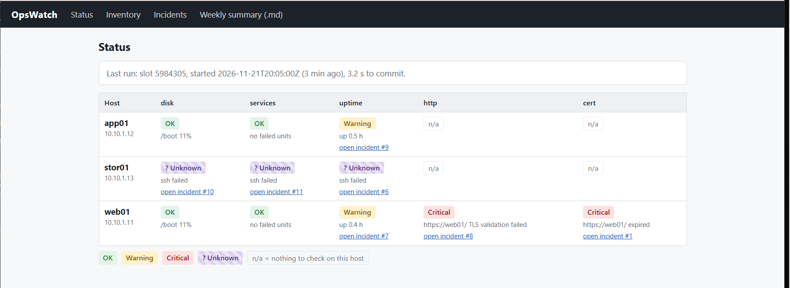

# OpsWatch

OpsWatch is an agentless Linux health console. A control node connects over SSH to a small set of Linux hosts every 5 minutes, checks disk usage, failed or stopped services, uptime, HTTP availability and TLS certificate expiry, and records every result in SQLite. When a check fails twice in a row it opens an incident with the raw evidence attached, and when the check passes twice in a row it resolves the incident on its own. A host that can't be reached shows as **Unknown**, never as healthy. OpsWatch only observes: it never changes a monitored host.



## Why it exists

Most monitoring tools ask you to install an agent on every box. On a small fleet, plain SSH with a read-only account and a dedicated key is enough, and it is something every Linux admin already understands and can audit. OpsWatch was built to show the whole operations loop on real infrastructure: provision, configure, observe, alert, diagnose, fix through code, and prove each step.

## What was built

| Layer | What | Where |
|---|---|---|
| Infrastructure | 4 Ubuntu 24.04 VMs on Azure (control node + web, app, storage hosts), private subnet, SSH allowed only from one admin IP, auto-shutdown, budget alert | `lab/azure/main.bicep` |
| Configuration | One idempotent Ansible playbook: nginx + TLS cert, demo service, data disk, read-only `opswatch` user, and OpsWatch itself | `lab/ansible/site.yml` |
| Check engine | Python 3, five checks per host, hard per-check deadlines, one SQLite transaction per run | `opswatch/` |
| Scheduling | systemd timer on fixed 5-minute slots (`OnCalendar=*:0/5`), one run at a time via `flock` | `deploy/systemd/` |
| Web UI | FastAPI status grid, incident timelines, Markdown incident reports and weekly summary; bound to localhost, reached by SSH tunnel | `opswatch/web.py` |
| Operations | Runbook per check, design decisions, evidence for every acceptance test | `RUNBOOK.md`, `DECISIONS.md`, `docs/evidence/` |

## Results on the live lab

| Measure | Result | Evidence |
|---|---|---|
| Full run, all hosts healthy (15 checks) | **1.6 s** process start to commit | [day-2](docs/evidence/day-2/README.md) |
| Full run with one host powered off | **10.08 s** (target < 15 s); dead host is `Unknown`, others unaffected | [day-2 #12](docs/evidence/day-2/README.md) |
| SSH stall found and fixed | Healthy run **9.8 s → 1.6 s** (`IdentitiesOnly=yes` + `IdentityAgent=none`) | [day-2 #8–11](docs/evidence/day-2/README.md) |
| Incident lifecycle with no human in the loop | Service stopped → incident on 2nd bad slot → fixed → resolved on 2nd good slot; 20 min | [day-8](docs/evidence/day-8/README.md) |
| Scheduler after 11 days powered off | Timer came back on boot, slot committed once with 15 results | [day-11 #3](docs/evidence/day-11/README.md) |
| Tests | **87 passing** (parsers, deadlines, streaks, missed slots, retries, rollback, web) | `tests/` |

### Real problems it caught

1. **nginx 403 on web01** on the very first live run: the site had no `index` directive. Fixed in the playbook.
2. **An expired TLS certificate** while the lab was unattended (Nov 19, 2026). OpsWatch escalated the cert incident from Warning to Critical and flagged HTTPS as failing. Diagnosed with `openssl s_client`, fixed by re-running the playbook (not by hand), verified with `curl`, and both alerts cleared on their own. [day-11 #5–8](docs/evidence/day-11/README.md)
3. **A disk-full drill** on the storage host: `/data` at 94% turned Critical within two runs, `du` located the file, cleanup returned it to 1%, and the incident resolved itself. [day-11 #9–12](docs/evidence/day-11/README.md)

## How it works

```
               every 5 min (systemd timer)
ops-ctl ──────────────────────────────────────────────┐
  │  SSH as read-only "opswatch" user, own key, 10 s   │
  ├──▶ web01   disk · services · uptime                │
  ├──▶ app01   disk · services · uptime                │
  ├──▶ stor01  disk · services · uptime                │
  │  HTTPS from ops-ctl, 5 s, hostname check on        │
  └──▶ https://web01/   http · cert                    │
                                                       ▼
            SQLite: runs · check_results · streaks · incidents
                                                       │
            Web UI on 127.0.0.1:8000 (SSH tunnel) ◀────┘
```

- **Severity:** OK, Warning, Critical, Unknown. Unknown means "could not tell", and it never counts as healthy.
- **Flap control:** an incident opens after 2 consecutive non-OK slots and resolves after 2 consecutive OK slots. A missed slot breaks a streak.
- **Run identity is the slot** (`floor(unix_time / 300)`), so a retried or overlapping run can never write twice.

Full rules: [`context/SPEC.md`](context/SPEC.md) and [`context/severity.md`](context/severity.md).

## Run it

```bash
# Build the lab (Azure Cloud Shell; full parameters in lab/azure/README.md)
az group create -n rg-opswatch-lab -l eastus
az deployment group create -g rg-opswatch-lab -f lab/azure/main.bicep -p ...

# Configure every host and deploy OpsWatch (on ops-ctl)
ansible-playbook -i lab/ansible/hosts.ini lab/ansible/site.yml

# On ops-ctl
python -m opswatch run            # dry run, prints JSON, writes nothing
python -m opswatch run --store    # commit one slot
bash deploy/verify-timer.sh       # prove the timer end to end

# From your laptop
ssh -L 8000:127.0.0.1:8000 azureuser@<ops-ctl>   # then open http://localhost:8000
```

Details and costs: [`lab/azure/README.md`](lab/azure/README.md).

## Repository map

| Path | Contents |
|---|---|
| `opswatch/` | Check engine, store, scheduler logic, web UI |
| `tests/` | pytest suite |
| `lab/azure/`, `lab/ansible/` | Infrastructure as code for the lab |
| `deploy/` | systemd units and the scheduler verification script |
| `RUNBOOK.md` | What each alert means, first three commands, likely causes, fix, when to escalate |
| `DECISIONS.md` | Each design choice and why |
| `docs/evidence/` | Screenshots and notes for every acceptance test, by day |
